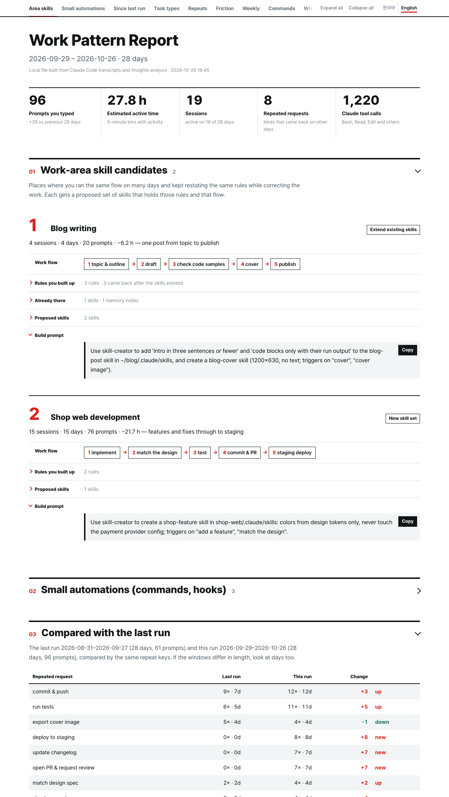

# work-pattern-report

**Version 0.1.1** (2026-10-26) · [Changelog](CHANGELOG.md) · MIT · **English** · [한국어](README_KO.md)

A Claude Code plugin that counts your own Claude Code history and shows, in one HTML report, **what you keep asking for** and **which of it is worth automating**.

It is a companion to the built-in `/insights` command, not a replacement. It counts what `/insights` doesn't.

| | `/insights` | work-pattern-report |
|---|---|---|
| Session goals, outcomes, friction | ✅ | reused from `/insights` |
| How many times, **on how many days**, you asked for the same thing | — | ✅ |
| Which commands Claude actually ran (`git commit`, `npm test`, …) | tool names only | ✅ command level |
| Automation candidates with a ready-to-paste build prompt | — | ✅ |
| Did the repeats go down after you automated? | — | ✅ compared with the last report |
| Report language | English | Korean / English toggle |



## Install

```text
/plugin marketplace add Soulddgy/work-pattern-report
/plugin install work-pattern-report@work-pattern-report
```

Requirements: Claude Code and Python 3.9+.

The "Where things got stuck" section uses the `/insights` analysis. If it is stale (last run more than a week ago, or covering less than half of the window), the skill stops before building the report and asks you to **run `/insights` first**. `/insights` only runs when you type it, so the skill cannot run it for you. Say "continue" after running it, or "go ahead" to build the report with what is there.

## Use

Ask in your own words:

- "What do I spend my Claude time on? Find things I could automate."
- "Weekly retro for last week."
- "Only my-app, October. Focus on things I keep asking for."
- "Compare the last two weeks with the two weeks before. Did the repeats go down?"

Results go to `~/Documents/work-pattern-report/`. The report opens in your browser and works offline.

To preview one first, download and open [`examples/sample-report.en.html`](examples/sample-report.en.html). It is built from made-up data.

## What's in the report

1. **Automation candidates** — what you do now, what it looks like automated, the numbers behind it, what you actually said, a design (when it runs, the steps, where it lives, what stays with you), a success check, and a build prompt
2. **Since last run** — whether each repeated request went up or down
3. **Task types** — where your prompts and time went
4. **Repeated requests** — counts, days and your own words
5. **Where things got stuck** — the `/insights` analysis, summarized
6. **Week by week, commands, prompts per day and project, longest sessions, observations**

## Privacy

Everything is processed on your machine. Transcripts can contain source code and internal discussions verbatim, so the skill never uploads or publishes the report unless you explicitly ask.

## Good to know

- **Categories are Claude's judgment.** Claude reads your prompts and sorts them into task types and repeated requests. A request that could fit two places ("deploy it") sometimes lands in the other one. Read the numbers for **size and order**, not exact values.
- **Active time is not working hours.** Only time with recorded conversation activity counts: time away is left out, and long stretches where Claude worked alone are included.
- **Friction only covers sessions `/insights` analyzed.** `/insights` doesn't analyze every session and may not have reached the most recent ones. The skill asks you to refresh it when it is stale, and the report shows its coverage.
- **It uses a fair number of tokens.** Claude reads and labels your history, so 30 days takes roughly 150k tokens per run. A shorter window costs less.
- **Claude Code updates can throw the counts off.** If the transcript format changes, some messages may be missed or miscounted. Please open an issue if numbers look wrong.
