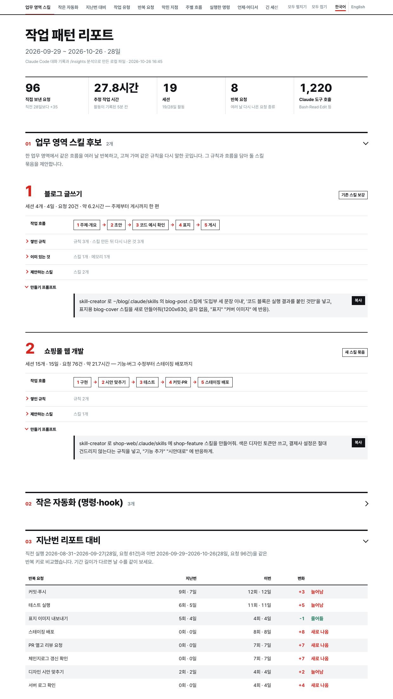

# work-pattern-report

**버전 0.1.1** (2026-10-26) · [변경 내역](CHANGELOG.md) · MIT · [English](README.md) · **한국어**

내 Claude Code 사용 기록을 세서 **자주 반복해서 시키는 일**과 **그중 자동화할 만한 것**을 HTML 리포트 한 장으로 보여 주는 Claude Code 플러그인입니다.

내장 명령 `/insights` 를 대체하지 않고 보완합니다. `/insights` 가 세지 않는 것들을 셉니다.

| | `/insights` | work-pattern-report |
|---|---|---|
| 세션 목표·결과·막힌 지점 | ✅ | `/insights` 결과를 가져와 씀 |
| 같은 요청을 몇 번, **며칠에 걸쳐** 했는지 | — | ✅ |
| Claude가 실제로 돌린 명령(`git commit`, `npm test` 등) | 도구 이름만 | ✅ 명령 단위 |
| 자동화 후보와 바로 쓸 수 있는 만들기 프롬프트 | — | ✅ |
| 자동화한 뒤 반복이 줄었는지 | — | ✅ 지난 리포트와 비교 |
| 리포트 언어 | 영어 | 한국어·영어 전환 |



## 설치

```text
/plugin marketplace add Soulddgy/work-pattern-report
/plugin install work-pattern-report@work-pattern-report
```

필요한 것: Claude Code, Python 3.9 이상.

"막힌 지점" 섹션은 `/insights` 분석을 가져다 씁니다. 분석이 오래됐으면(마지막 실행이 일주일 넘게 지났거나 이번 기간 세션의 절반도 반영 안 됐으면) 리포트를 만들기 전에 **"`/insights` 를 먼저 돌려 주세요"** 하고 멈춥니다. `/insights` 는 사용자가 직접 입력해야만 실행되는 명령이라 스킬이 대신 돌릴 수 없습니다. 돌린 뒤 "계속"이라고 하면 이어서 만들고, "그냥 진행"이라고 하면 있는 데이터로 만듭니다.

## 사용법

평소 말투로 요청하면 됩니다.

- "내가 무슨 작업 많이 하는지 보여주고 자동화할 만한 것도 뽑아줘"
- "지난주 주간 회고 하게 정리해줘"
- "my-app 만 놓고 10월에 반복해서 시킨 일 위주로 분석해줘"
- "최근 2주를 그 전 2주랑 비교해서 반복이 줄었는지 보여줘"

결과는 `~/Documents/work-pattern-report/` 에 생깁니다. 리포트 파일은 브라우저에서 열리고, 인터넷 없이도 보입니다.

미리 보고 싶으면 [`examples/sample-report.ko.html`](examples/sample-report.ko.html) 을 내려받아 열어 보세요. 가짜 데이터로 만든 리포트입니다.

## 리포트에 나오는 것

1. **자동화 후보**: 지금 어떻게 하고 있는지, 자동화하면 어떻게 되는지, 근거 숫자, 실제로 하신 말, 설계(언제 실행되나, 단계, 만들 위치, 사람이 남길 일), 성공 기준, 만들기 프롬프트
2. **지난번 리포트 대비**: 반복 요청별로 늘었는지 줄었는지
3. **작업 유형**: 무슨 일에 요청과 시간을 많이 썼는지
4. **반복 요청**: 같은 요청의 횟수·날 수와 실제 문장
5. **막힌 지점**: `/insights` 분석을 한국어로 정리
6. **주별 흐름, 실행한 명령, 날짜·프로젝트별 분포, 긴 세션, 관찰**

## 개인정보

모든 처리는 내 컴퓨터 안에서만 합니다. 대화 기록에는 소스 코드나 사내 논의가 그대로 들어 있을 수 있어서, 스킬은 사용자가 직접 요청하기 전에는 리포트를 어디에도 올리지 않습니다.

## 알아둘 점

- **분류는 Claude의 판단입니다.** 요청을 작업 유형과 반복 요청으로 나누는 건 Claude가 문장을 읽고 정합니다. "배포해줘"처럼 어느 쪽에도 들어갈 수 있는 요청은 다른 칸에 들어가기도 합니다. 숫자는 정확한 값보다 **크기와 순서**로 보세요.
- **작업 시간은 근무 시간이 아닙니다.** 대화 기록이 남아 있는 시간만 셉니다. 자리를 비운 시간은 빠지고, Claude가 혼자 오래 작업한 시간은 들어갑니다.
- **막힌 지점은 `/insights` 가 분석한 세션만 나옵니다.** `/insights` 는 모든 세션을 분석하지 않고, 최근 세션은 아직 빠져 있을 수 있습니다. 오래됐으면 스킬이 먼저 돌리라고 알려 주고, 리포트에도 몇 개 세션에 적용됐는지 표시됩니다.
- **토큰을 꽤 씁니다.** Claude가 대화 기록을 읽고 분류하기 때문에, 30일치 기준으로 한 번에 약 15만 토큰이 듭니다. 기간을 짧게 잡으면 줄어듭니다.
- **Claude Code가 업데이트되면 숫자가 틀어질 수 있습니다.** 기록 파일 형식이 바뀌면 일부가 빠지거나 잘못 셀 수 있습니다. 이상하면 이슈로 알려 주세요.
